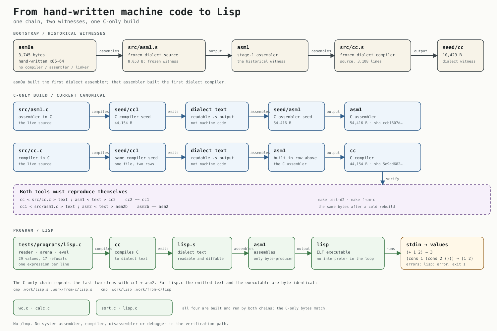

# asm-bootstrap



*The chain: hand-written machine code → the dialect assembler → the dialect compiler → the
C-only rebuild → `lisp.c` compiled, assembled and running.*


**A self-hosting assembler and C compiler, bootstrapped from machine code that an LLM wrote by
hand.**

Nothing at the bottom of this repository came out of another program. The seed is 3 745 bytes of
x86-64 written as literal bytes — no compiler, assembler, linker, interpreter or script produced
them — and every artifact above it exists because a source file was assembled by something that
descends from those bytes. The seed and four stages above it, each with a gate that is a property of the
build rather than a claim about it:

| stage | what it is | what makes it true |
|---|---|---|
| 0 | `asm0a`, 3 745 B of machine code, no tool involved | it runs, and assembles the stage-1 source |
| 1 | the assembler in its own dialect (`src/asm1.s`, frozen witness) | 8 053 B when promoted; `make test-frozen` pins the source, and `src/cc.s` still assembles to `seed/cc` |
| 2 | the assembler in C (`src/asm1.c`) | `seed/cc1` + `seed/asm1` build it; it reproduces itself from its own C text: 54 416 B, sha `ccb1607d…` |
| 3 | the compiler in C (`src/cc.c`) | `asm1` builds it from its own C text to 44 154 B, sha `5e9ad682…`, and it recompiles that text identically |
| 4 | the programs (`wc`, `calc`, `sort`, `lisp`) | each is built and run by both `cc`+`asm1` and the C-only `cc1`+`asm2`, with identical bytes |

**Status: the C-only chain is complete.** `make check` and `make from-c` are green, and the three
filed programs (#5 calc, #6 sort, #7 lisp) are implemented and exercised on both chains. The
remaining roadmap items — `.data`, wider addressing forms, closures/GC in the Lisp — are deliberately
out of scope for this repository's goal, not hidden gaps in it.

"Self-hosting" is therefore not a description of this project but the *failure condition* of its
build: `make check` stops if an assembler cannot reproduce itself, or a compiler cannot compile its
own source to the same text.

## What the model changes about the method

An LLM emits confident bytes. Its failure mode is not that it cannot write machine code — it wrote
every byte of `asm0a` with no assembler to check them, and later a compiler in a language it was
inventing as it went. Its failure mode is the plausible wrong one: a byte count that forgot the REX
prefix, a patch written one byte into a two-byte opcode, a symbol address that is a file offset
where a segment offset was meant. None of that is visible by reading, and the model is the last
thing in the loop you should ask.

So the method is oracles, not care. Every wave is judged against bytes written *before* the tool
that produced them existed; every gate has been demonstrated failing at least once; every claim in
the log names the mechanism that caught it. Over thirty defects are recorded in `docs/WAVES.md` with
their cause and their catcher, and every one of them was caught by decoding, comparing or executing
the artifact — **none by re-reading the code**. A rule written down as prose was violated again two
waves later; the same rule mechanised (`tools/check-branches.sh`: 290 pinned branch sites, with a
`--selftest` that must fail) has held ever since.

That is what this project is about: not that a model can bootstrap a toolchain, but that a bootstrap
is a chain of trust, and an LLM is exactly the kind of producer that needs one.

**No compiler, no system assembler, no disassembler, no interpreter, no debugger** appears in the
*verification* path: `make test-tools` fails if one is invoked anywhere in the `Makefile` or `tools/`;
`objdump` is on that list, because a disassembler is the tool this project replaces and so cannot be the
thing that verifies it (`src/dis.s` is the decoder that replaced it).

**And one violation, disclosed rather than buried:** the source of `asm1` was *written by a Python
generator*, twice, in the wave that gave it an ELF header, and the 120-byte header it embeds was copied
out of a reference binary by that script. Nothing said so until it was pointed out.
`docs/violations/asm1-was-generated.md` records what happened, what survives in the committed source,
and what the gates therefore do and do not establish. The artifact is still judged by bytes — that is
what every gate below does — but the claim this project makes is about *provenance*, and the oldest
commit in it was made with a tool this file used to say was never used.

The assembler is still bootstrapped from itself and from hand-emitted references. What the disclosure
changes is the sentence a reader is entitled to rely on: the *artifacts* are verified by bytes; the
*source* of the assembler was generated once, and the 120 header bytes it embeds are checked against
a documented table (`make test-header`) rather than trusted.

A second violation is recorded in `docs/violations/python-in-edit-and-diagnosis.md`: `python3` was used
in one session's editing and diagnosis path. It produced no artifact's content, and every gate below
still passed, which is exactly why it is written down — `make test-tools` cannot see an interactive
invocation.

`docs/pdp8-to-gcc.md` has the history that motivates the shape (PAL-III, its unnamed original
author, the paper-tape two-pass design, and the line from there to `as` and `gcc`); `docs/WAVES.md`
is the log, failures included; `docs/continue-here.md` is where a session starts.

## Where this stands

| | artifact | bytes | sha256 (16) | built by |
|---|---|---|---|---|
| bootstrap | `asm0a` | 3 745 | `6271c5ee79034ffd` | hand-written, **frozen** |
| dialect witness | `seed/cc` | 10 429 | `a81345ad5a67490d` | `asm1` from the frozen `src/cc.s` |
| assembler | `asm1` | 54 416 | `ccb1607db88a2ee1` | `seed/cc1` + `seed/asm1` from `src/asm1.c` |
| seed assembler | `seed/asm1` | 54 416 | `ccb1607db88a2ee1` | the promoted C assembler |
| compiler | `cc` | 44 154 | `5e9ad682b3564711` | `asm1` from `src/cc.c` |
| seed compiler | `seed/cc1` | 44 154 | `5e9ad682b3564711` | the promoted C compiler |
| decoder | `dis` | 1 343 | `2d2eb451d7c7a9a9` | `asm1` from `src/dis.s` |
| C-only assembler | `asm2` | 54 416 | `ccb1607db88a2ee1` | `cc` + `asm1` from `src/asm1.c` |
| C-only compiler | `cc1` | 44 154 | `5e9ad682b3564711` | `cc` + `asm1` from `src/cc.c` |

Past the bootstrap. The canonical `asm1` is now the **C assembler** built from `src/asm1.c`; it
reaches its own fixpoint, reproduces `asm1` on the whole corpus, and is demonstrably better than what
built it — 9 byte-level cases where `asm0a` answers wrongly and 36 syntax pairs it cannot parse.
`src/asm1.s` is frozen history and the witness; `make bootstrap-check` says **NOT APPLICABLE** out
loud rather than passing quietly.

The compiler is real: `int x = 3`, `while`, `if`/`else`, thirty-two variables, expressions with
precedence, function calls, recursion, pointers (`&x`, `*p`, `*p = v`), int and char arrays, a buffer
that can cross a call, `read()`, `write()` and `exit()`, over a 64-bit value model. Comparisons are
signed (`jl`/`jg`), `/` and `%` are signed (`cqo` + `idiv`), and the compiler emits text, not bytes.

**And it compiles itself.** `src/cc.c` is the compiler written in the subset it compiles; `cc` is that
C compiler, and it compiles `src/cc.c` to identical text (`make test-d2`). `src/asm1.c` is the
assembler in the same subset; `asm1` builds `src/asm1.c` to itself and passes `make test-asm2`
(**234** corpus and self-assembly checks). `make from-c` rebuilds both from the committed seeds
(`seed/cc1`, `seed/asm1`) in the assembler-then-compiler order, with both fixpoints; `make test-frozen`
pins all **161** `.s` sources, including the signed-form fixture.

**Four real programs exercise the C-only chain.** `tests/programs/wc.c` counts lines, words and
characters; `tests/programs/calc.c` is a signed recursive-descent calculator; `tests/programs/sort.c`
sorts lines over the full 200000-byte input; `tests/programs/lisp.c` is a small Lisp interpreter with a
reader, a fixed 4096-node arena, `define`, `if`, arithmetic, comparisons, `car`/`cdr`/`cons` and a
single fixed error path. `make test-program` builds all four with `cc`+`asm1`; `make from-c` builds
them with the C-built `cc1`+`asm2`, after rebuilding both tools from source.

### Differences from C

These are deliberate, and the differential gate (`tools/differential.sh`) compares the programs it can
express against `gcc -O0 -funsigned-char`:

- `char` is **zero-extended**, like `gcc -funsigned-char`; `char x = 65;` (a scalar) is refused.
- `int` is **64-bit**; there is no `sizeof`, no `struct`, no global, no `&&`/`||`, no `else if`, no
  `for`, `break` or `switch`.
- `read` and `write` are two-argument builtins (`read(buf, n)`, `write(buf, n)`); `exit(n)` stops.
- Functions take up to four `int` arguments, have 32 variables, a 260000-byte frame and
  arrays up to 255000 bytes; the compiler reads at most 200000 bytes of source, and constants go to
  16 777 215. A program may cap its own input smaller (60000 in lisp, 200000 in sort).
- `<=` and `>=` are normalised to `<`/`>` with an adjusted bound, so `x <= 255` and `x >= 0` are
  refused; write `x < 256` instead.
- A string is an address; `db` literals are zero-terminated; a bare array name is not a value (use
  `&a`), and a call cannot appear in another call's argument list.

### Where things live

Everything is in the repository. There is no `/tmp`: tooling, probes and evidence are committed and
named in a document, and build output — an assembled binary, a compiled `.s`, a run's stderr — lives in
`.work/`, which is ignored by git and described here. `make test-tmp` fails if `/tmp` or a bare `mktemp`
reappears in the `Makefile` or `tools/*.sh`. The rule exists because the generator that wrote
`src/asm1.s` survived 141 commits in `/tmp`, where no reader could find it and no review could see it
(`docs/violations/asm1-was-generated.md`).

## Use it

`asm1` (and `asm0a`) read source on **stdin** and write the executable on **stdout**. They take no
arguments, so the shell supplies the filenames:

```bash
make
```

builds `asm1` from `src/asm1.c` with `seed/cc1` + `seed/asm1`, the decoder with `asm1`, and `cc`
from `src/cc.c` with `seed/cc1` + `asm1`. Then `make check` runs the gates: the frozen-source
witness, the C assembler's fixpoint, the port against every golden, coverage, provenance and the
branch pins.

```bash
./asm1 < src/count10.s > count10 && chmod +x count10 && ./count10
```

prints `1`…`10`. `chmod` is required because a pipe cannot carry a mode bit. To prove the output is
the *verified* object rather than merely something that runs:

```bash
./asm1 < src/count10.s | cmp - ref/count10 && echo identical
```

`ref/count10` was written by hand, before any assembler here could read its source — an oracle
cannot be produced by the thing it judges.

The whole pipeline is one command:

```bash
make hello
```

## The C compiler: `cc`

`cc` compiles a subset of C to this dialect's **text**. Not bytes: its output is a file you can read
and diff, it is compared byte for byte against a hand-written golden, and `asm1` stays the only thing
that produces an executable, so every assembler gate applies to the compiler's output too. The text
begins with a `;` comment saying what it is — a comment to the assembler, a shell syntax error to
anything that tries to run it directly.

| step | what it added | gate |
|---|---|---|
| 1 | `int x = N`, `x = x ± N`, `while (x)` | `twowrites` golden; `loop` compared by output with `tests/oracle/dots.s` |
| 2 | `== != < > <= >=`, `if`/`else` — no new instruction, `jb`/`jz`/`jnz` plus an operand swap | same output as `tests/oracle/branch.s` |
| 3 | a symbol table: variables and names | `twovars` golden and oracle |
| 4 | expressions with precedence, one register per depth | `(2 + 3*4) - 10 + 14` exits 18 |
| 5 | a calling convention: args in `rdi`/`rsi`/`rdx`/`rcx`, return in `eax` | `add(2,3)` exits 5, `sub2(3,2)` exits 1 |
| 6 | `return` anywhere, arguments as `+`/`-` terms, recursion | `f(10,0)` with an accumulator exits 10 |
| 7 | 64-bit values, then `&x`, `*p`, `*p = v` — addresses, with no type system yet | `*p = 33` after `int y = *p` exits 40; a callee writing through `&x` exits 42 |
| 8 | `int a[N];`, `a[i]`, `a[i] = v` — the index may be any expression | `a[0] + a[i]` with `i=2` exits 42; `f(a[i])` exits 42 |
| 9 | a call inside a larger expression — the live registers are pushed around it | `fact(5)` exits 120; `sum(4)` exits 10 |
| 10 | `char a[N];` — one byte per element, no stride | `a[0]=65, a[i]=66` exits 131; `char a[9]` beside an `int` exits 72 |
| 11 | `(expr)` grouping, `write(buf, n)`, `read(buf, n)`, and a term in a condition | `putn(1234)` prints 1234; `cat` copies stdin byte for byte |
| 12 | `/`, `%`, character literals, 15-character names, `exit(n)` | `q=100/7; r=100%7; q*10+r` exits 142; `exit(3)` stops with 3 |
| 13 | **the port** — the compiler written in the subset it compiles | `make test-port` 43/43 byte-identical; `make test-d2` self-hosted |
| 14 | signed `< > <= >=`, signed `/` and `%` (`jl`/`jg`, `cqo` + `idiv`) | `tools/differential.sh` 5/5 vs `gcc -O0`; `calc` 10/10, including negative division |

The subset, exactly: `int` scalars, `int a[N]` and `char a[N]` arrays, assignment (through `*p` and
`a[i]`), `while`, `if`/`else`, `return`, six comparisons, `+ - * / %` with precedence, parentheses,
`&`/`*` on a name, function definitions with up to four `int` arguments, calls, recursion,
`read(buf, n)`, `write(buf, n)`, `exit(n)`, and string/char/number literals. Values are 64-bit; an
`int` may hold an address and the compiler neither knows nor checks which.
Limits: 32 variables per function, names up to 15 characters, four arguments, expression depth 6, a
260000-byte frame, arrays up to 255000 bytes in total, 2048 labels, and comparison bounds that are a
literal, character or variable — `x <= 255` and `x >= 0` are refused because normalising them would
need a bound outside 0..255.

Boundaries are refusals with no output, and all **36** are pinned in `make test-cc`: `int main()`
without `void`, `void main`, an undeclared name, a duplicate declaration, a 33rd variable, a
16-character name, an assignment inside a condition, `else if`, `x <= 255`, `x >= 0`, a bitwise `&`,
an unterminated string or comment, a literal above 16 777 215, `write(x)` with no string, `read` into a
non-array or without a count, five arguments, a call inside an argument list (`f(f())`), `&5`, `*q`
with `q` undeclared, `&nope`, a bare array or an array used as a value, `read(&s, 4)`, a nested
subscript, an `int a[9000]` (72 000 bytes), a duplicate array, a `char` scalar, `char a[4]; a = 1;`,
and two locals with the same name in one function. `docs/cc.md` gives the reason for each — most are
consequences of a choice, not of an omission.

Three kinds of check, because each sees something the others cannot:

- **text goldens** — 43 programs (42 in `tests/golden/`, plus `helloworld.c`) whose emitted dialect is
  pinned byte for byte. A regression pin, not an oracle: it cannot tell a plausible mistake from a
  correct answer, which is what the next two are for.
- **behaviour** — each one is assembled and run; the exact exit code or stdout is asserted. This is
  the machine judging the code generator.
- **oracles** — three hand-written dialect programs that do the same job, compared by *output*
  ("two sources, one behaviour"). The only gate that catches plausible-but-wrong codegen.

### The defect that was explained

`cc` used to refuse a nested `expr`, because nesting it corrupted the symbol-name buffer and the
writer of those bytes could not be found. The writer is now known: **`cc` never reserved stack.** Its
prologue was `lea rbp, [rsp]` and nothing else, so every `call` pushed a return address into the slots
where `cc` keeps its state — and `[rbp-208]`, the "inside an argument list" flag, is exactly the
`1` that appeared where a name should have been. `mov ecx, 320; sub rsp, rcx` fixed it, and with that
in place the parse that had corrupted the buffer produces byte-identical output.

So the guard is gone, and so is `argexpr`, the smaller parser written to avoid nesting: an argument is
now a whole expression, which is why `f(x * 2)` works (`docs/cc.md`, `docs/WAVES.md`).

What is still refused is narrower still: a call inside an *argument list* (`f(g(1))`), because it
would overwrite the argument registers — a different resource from the depth registers, and the one
place where the fix is not a push.

### Arrays grow down

An array's base is `rbp - end`, not `rbp - start`: the allocator stores the end of the reserved
region, so `a[i]` lands at `rbp-end+i` and a large first array cannot grow up through `rbp` into the
caller. The old layout only worked while the first array was small and its indices stayed small; a
900-byte array in a callee overwrote the return address. The gate is `tests/golden/arrlocal.c`: a
900-byte local array in a callee, read back, exits 72.

## The compiler compiles itself

`src/cc.c` is the compiler written in the subset it compiles: scanner, symbol table, arrays,
expressions with precedence, division, calls, recursion, conditions, literals, `read`, `write` and
`exit`. It keeps its world in one `char mem[210000]`, because a pointer subscript in this dialect is a
byte subscript, and it validates in one pass and emits in a second.

The proof has two halves, and both are run by `make check`:

```
make test-port    43/43 goldens byte-identical to cc, and the port-built putn prints 4321
make test-d2      THE PORT COMPILES ITSELF -- cc1.s and cc2.s are identical, 140388 bytes
```

`test-port` is the part that is not self-consistency: the port's output is compared with the dialect
compiler's on every golden. `docs/cc.md` (Stage 11) records the five defects building it found in the
compiler it was porting, and the one language addition — `exit(n)`, which lets a routine stop a
program with no partial output.

## The goal

```bash
src/asm1.c  →  cc  →  asm1  →  asm2
```

`cc` in C is done (step 4), and so is `asm2` (step 5): `src/asm1.c` is compiled by `cc`, assembled
by `asm1`, and required to be **byte-identical to `asm1` on the whole corpus** — every fixture, every
capability pair, every rejection and exact message, the 99 KB source, and its own compiler text. The
C-only chain then rebuilds both tools from `seed/cc1` + `seed/asm1` (`make from-c`), with `cc2 == cc1`
and `asm2b == asm2`.

What that buys, and why the corpus is the criterion rather than "it runs": an assembler that produces
the same bytes on 18 hand-emitted references, 36 syntax pairs, 290 pinned branches and a fixpoint is
the same program in every way this repository can measure. The standing counterexample is `asm0a`,
which assembled `and eax, ecx` as `add` and agreed with itself perfectly while doing it; agreement
between implementations is evidence about *them* until neither is known to be wrong.

Why it matters at all is Thompson, 1984: a tool can carry a miscompilation that no amount of reading
its source reveals. The defence is never one check. It is a ladder of independent ones — hand-written
references, refusals, superiority cases, a fixpoint, a provenance ledger, one decoder written in the
dialect, and a differential against gcc for the parts both dialects can express. `docs/oracles.md`
ranks the rungs and says what each one does *not* prove.

The frozen `src/asm1.s` and `src/cc.s` are the witnesses; the canonical `asm1` and `cc` are the C
builds. The assembler still lacks `.data`, `add r32, imm32`, `cmp`/`test`/`mov` with `[mem]`,
`[base+index*scale]`, and `imul r, r, imm`. Those are the ordered roadmap, not prerequisites for the
C-only chain: the four programs are the evidence that the subset is useful without them.

## Provenance: which assembler built this?

`asm0a` is frozen; the live sources are `src/asm1.c` and `src/cc.c`, so the tools change and an artifact is meaningful only
together with *which build of which assembler* produced it. "asm1" identifies nothing once asm1 has
been rebuilt, so every record is a sha256 pair.

`docs/provenance.tsv` — one line per artifact per assembler:

```
addr32  734b5a48…  asm0a  6271c5ee…       artifact sha, assembler, assembler sha
addr32  734b5a48…  asm1   ccb1607d…
```

`docs/asm1.sha` pins the sha256 of the current `asm1`, so the build is identified as a *content* claim
rather than by name. `make record` rebuilds everything and rewrites both files, and it is the only
thing that writes them: recording is an assertion that a change is intended, and a build step that
absorbed drift silently is exactly how a stale record goes unnoticed.

`make which FILE=count10` answers the question directly, by looking the file's content sha up in the
ledger; unknown content exits non-zero rather than saying nothing.

## The bootstrap chain

`asm0a` is frozen, and `src/asm1.s` and `src/cc.s` are frozen witnesses. The live assembler is
`src/asm1.c`, built from the C seed chain:

```
seed/cc1 < src/asm1.c > text ; seed/asm1 < text > asm1
cc      < src/asm1.c > text ; asm1      < text > asm1b ; cmp asm1 asm1b
seed/cc1 < src/cc.c   > text ; asm1      < text > cc
cc      < src/cc.c   > text ; asm1      < text > cc2    ; cmp cc cc2
```

`seed/asm1` and `seed/cc1` are the promoted C assembler and compiler; `seed/cc` is the frozen
dialect compiler witness. A binary is never its own reference.

`make promote` replaces `seed/asm1` and is a deliberate act with a diff to read. `docs/toolchain.tsv`
records every promotion: the stage's sha256, its builder, and that builder's sha256. The chain runs
back to `asm0a`, the one link with no builder — recorded as `-`.

`make bootstrap-check` used to require that `asm0a` and `seed/asm1` — two independent
implementations — agree on `src/asm1.s`. That is now **NOT APPLICABLE**: the source grew past
`asm0a`'s 128-label limit, so `asm0a` cannot parse it. The check says so out loud and names the
reason, because a check that cannot run is not a check that passed. What holds the chain up instead,
in order of strength: `ref/`; the rejection, capability and superiority suites; the fixpoint; and the
promotion ledger, with every earlier generation recoverable by `git show <rev>:seed/asm1`.

Triage, when a build fails: the same binary is both tool and subject, so a failure could be your edit
or your seed. `make triage` asks which artefact is inconsistent with the last commit — a state that
passed every gate when it was made — instead of guessing and bisecting source.

## Milestones

Two tags mark the points where the project changed kind. Both carry the evidence in the tag message,
so `git tag -n99` reads without the repository.

| tag | commit | what it marks |
|---|---|---|
| `milestone-fixpoint` | `c2240bf` | `asm1` assembles itself: `X == X' == X''`, 4 295 bytes, one sha256 |
| `milestone-handover` | `c806e95` | `asm1` is better than `asm0a` — and `asm0a` can no longer build it |

Rebuilding them. There was no `Makefile` at the fixpoint commit, so the path is the two commands the
commit itself documents:

```bash
mkdir -p .work/fx && git archive milestone-fixpoint | tar -x -C .work/fx && cd .work/fx && ./asm0a < src/asm1.s > X && chmod +x X && ./X < src/asm1.s > Xp && cmp X Xp && echo identical
```

At the handover tag `asm0a` is no longer a valid builder and `make` uses `seed/asm1`:

```bash
mkdir -p .work/ho && git archive milestone-handover | tar -x -C .work/ho && cd .work/ho && make > /dev/null && ./asm1 < src/asm1.s | cmp - asm1 && echo identical
```

Each prints `identical`, and `milestone-fixpoint` produces 4 295 bytes with sha256 `250e02c9…` while
`milestone-handover` produces 5 094 bytes with sha256 `7a10451b…` — the values the tag messages claim.

## The gates, in detail

| | |
|---|---|
| builder | `asm1` is built from `src/asm1.c` by `seed/cc1` + `seed/asm1`, never by itself. `src/asm1.s` is the frozen witness; `asm0a` can no longer parse it, so `make bootstrap-check` reports NOT APPLICABLE |
| fixpoint | `asm1(asm1.c.s) == asm1`, 54 416 bytes, one sha256; `cc` rebuilds `src/cc.c` to itself |
| fixtures | 18 in `ref/`, all byte-identical to hand-emitted references and behaviourally correct |
| rejections | 9 sources refused by both assemblers with no output, and 8 exact messages: line number *and* reason |
| capability | 36 pairs where `asm1` accepts syntax `asm0a` cannot parse; both spellings must agree byte for byte |
| coverage | 100 claimed forms, each required to appear in a test input (`make test-coverage`) — the gate that says which paths nothing has ever executed |
| superior | eight byte-level cases where `asm1` is right and `asm0a` is not (`and`-as-`add`, `[rbp]` disp 0, a negative disp, 64-bit vs 32-bit width, `r8`–`r15`, disp32, `div`, space), each against a hand-computed body; plus a 99 KB source, a chosen `entry` point and `r8d` arithmetic, which must RUN |
| branches | 290 sites in `docs/branches.tsv`, all decoded by `src/dis.s` — a decoder written in the dialect and assembled by `asm1` |
| source language | `mov` (8/32/64-bit, register, immediate and memory), `add`, `sub`, `cmp`, `and`, `or`, `xor`, `test`, `imul`, `inc`, `dec`, `neg`, `not`, `shl`/`shr`/`sar`, `movzx`, `lea`, `div r32`/`div r64`, `idiv r32`/`idiv r64`, `cqo`, `push`/`pop`, `call`/`ret`, `syscall`, `jmp`/`jz`/`jnz`/`jl`/`jle`/`jg`/`jge`/`js` with rel8 and `.l` rel32, `[base]` and `[base+index]` with disp8/disp32, `db` with strings, labels, expressions (`label+4`, `end - start`), `entry`, two-pass assembly with validation, hex/char/negative literals. Width comes from the operand names and a mixed pair is refused; registers `rax`…`r15` with `REX.R`/`X`/`B` |
| not in the language | `imul r,r,imm`, `div`/`idiv` need a register of 32 or 64 bits, not 8, `[base+index*scale]`, `je`/`jne`/`ja`/`jae`/`jbe`/`jo` as mnemonics, `cmp r32,[mem]`, `mov` between two memory operands, rel8 beyond 127 bytes (use `.l`), names longer than 15 characters |
| compiler | `cc`, 44 154 bytes, built by `asm1` from `src/cc.c`: C subset → dialect **text** → `asm1` → executable. Signed `<`/`>`/`<=`/`>=`, signed `/` and `%`. 43 text goldens, 3 output oracles, 36 refusals (`make test-cc`, `docs/cc.md`). **The compiler compiles itself**; `make test-port` shows its output byte-identical on all 43 goldens, and `make test-d2` shows `cc1.s == cc2.s` |
| `make check` | forbidden tools, `frozen: 161 assembly sources unchanged`, nothing-outside-the-tree, frozen `src/cc.s` still equals `seed/cc`, the port's 43/43 goldens, `cc1.s == cc2.s`, header table, coverage 113/113, fixpoint, bootstrap NOT APPLICABLE, 9/9 rejections, 8/8 messages, 36/36 capability, nine superiority cases plus three behavioural, 38/38 decoder cases, the compiler's 45 checks including `exit(3)` and the callee-local array, the assembler-in-C gate (234 checks), the wc program (4/4 inputs), the calc program (10/10 results, 2/2 refusals), the sort program (6/6 ordered, 2/2 refusals), the lisp program (29/29 values, 17/17 refusals including arena and buffer limits), 36 provenance records, `docs/SHAS`, `docs/asm1.sha`, 290/290 branch pins — every line able to fail |

`ref/` holds binaries written by hand **before** the assembler could read their source. They are
never regenerated casually: a binary whose bytes you did not write cannot judge an assembler.
`docs/oracles.md` explains what those references do and do not prove, and why byte-identity with a
hand-written reference is a floor rather than a proof.

Two rules that have each caught a real defect here:

- **Exit status is never evidence.** Every test compares bytes with `cmp`. A stage can exit 0 and
  leave a stale binary in place reporting green.
- **A zero is not a clean result.** An absence check cannot tell "removed" from "never there", so
  every gate that counts something also asserts the thing it counts exists.
